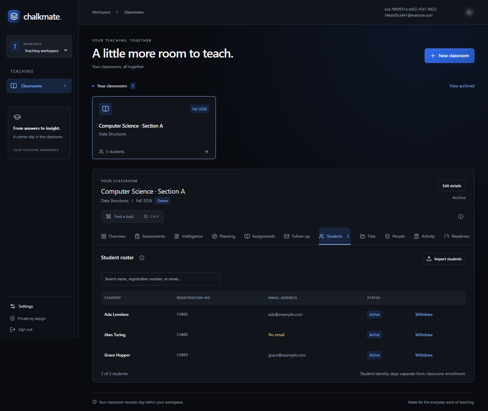
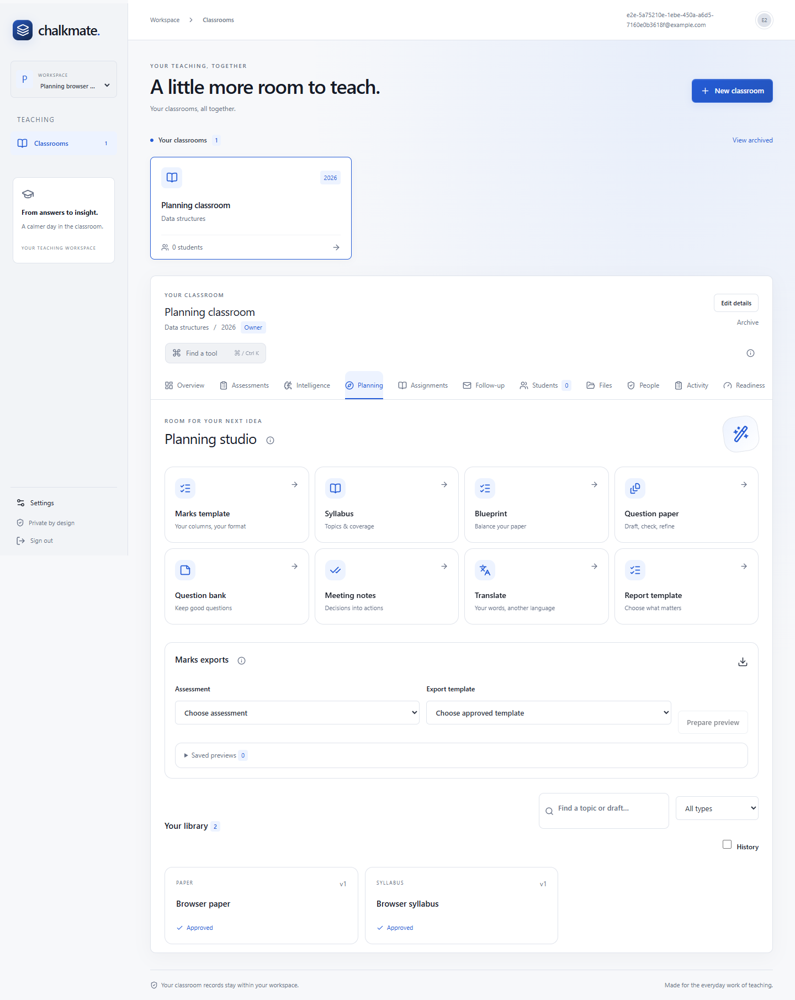

# Chalkmate

A calmer workspace for the full teaching cycle: organize a classroom, review assessments, release feedback, and plan the next lesson.

Chalkmate brings roster management, versioned rubrics, optional local AI suggestions, private student assignments, reviewed follow-up and syllabus-based planning into one app. Teachers approve marks, publication and messages. Runs locally with **Next.js/React, FastAPI, Supabase/PostgreSQL, Redis/Celery and Ollama**.

Start with the [user guide](docs/USER-GUIDE.md). See [release status and remaining external gates](docs/RELEASE-STATUS.md), [verification](docs/release-verification.md), and [backup/restore](docs/phase-nine.md).

## Screenshots



**Classroom workspace:** manage student rosters and move between assessments, assignments and follow-up in the dark blue theme.



**Planning studio:** prepare syllabus-based papers, question banks, notes and reusable marks exports in light mode.

Screenshots use synthetic demo records.

## Start on this computer

Open Docker Desktop, then run from this folder in PowerShell:

```powershell
.\scripts\Start-Chalkmate.ps1
```

The launcher starts local Supabase, applies migrations, rebuilds workers/web and starts the API/web in the background. It prints the app address: normally http://localhost:3000, or http://localhost:3001 when another project occupies port 3000. Existing applications are not stopped. Use `-SkipBuild` only when the current web source has already been built. Ollama is optional; run `ollama serve` separately for installed local models. Grading model selection remains explicit.

```powershell
.\scripts\Status-Chalkmate.ps1
.\scripts\Stop-Chalkmate.ps1
# Also stop this project's containers, preserving database/file volumes:
.\scripts\Stop-Chalkmate.ps1 -Services
```

Stop only handles app processes created by the launcher after verifying their identity. An app started manually must be stopped in its own terminal. Do not use volume removal or database reset commands to stop the app.

## First installation

Requires Node.js 24, Python 3.12, and Docker Desktop with its Linux engine. In a fresh checkout:

```powershell
git clone https://github.com/kailashp-27/Chalkmate.git
cd Chalkmate
npm.cmd ci
python -m venv .venv
.\.venv\Scripts\python.exe -m pip install -r requirements.lock.txt
.\.venv\Scripts\python.exe -m pip install --no-deps -e .
.\scripts\Start-Chalkmate.ps1
```

Setup creates ignored root `.env` and `apps/web/.env.local` files and a private file bucket. Supabase owns database/auth/storage migrations; Alembic owns only application migrations/RLS. The API and worker use restricted database roles. No hosted account is provisioned. Development messages stay in [the local email inbox](http://127.0.0.1:54324), including account verification and password recovery; they do not arrive in Gmail.

Create/verify an account, sign in and create a workspace/classroom. For the existing synthetic demonstration account, run `.venv/Scripts/python.exe scripts/create_demo_account.py`, then open the private `.tmp/demo-credentials.json` on your computer. Never share that file or `.env`.

## Workflows

- **Students / People / Files:** roster preview/import, verified invitations, scoped teacher/reviewer access and private resources.
- **Assessments:** immutable rubric versions, calibrated local suggestions/manual marks, extraction correction, question review, approval, explicit release and preserved replacement history.
- **Overview:** classroom task counts and student question-review requests. Teacher replies do not change marks automatically.
- **Assignments / Follow-up:** private submissions, reviewed audiences, strict score filters, explicit message approval, scheduling and durable delivery recovery.
- **Intelligence / Planning:** evidence-backed findings, remedial work, approved syllabus sources, blueprints, banks/papers/variants, notes/translations and recorded-data reports.
- **Reporting / Readiness:** reusable CSV/Excel marks templates, frozen export previews, bank-question performance links, service/worker checks and local recovery evidence.

Dark/light/system themes, concise info tips, finite motion and reduced-motion support are shared across the app. Ctrl/Cmd K finds tools. Teachers retain approval of marks, publication and messages. Missing work is never silently scored zero.

## Development and verification

API docs: http://127.0.0.1:8100/docs. Manual development commands: `.venv/Scripts/python.exe -m uvicorn chalkmate.main:app --host 127.0.0.1 --port 8100` and `npm.cmd run dev`. When using port 3001, set `WEB_ORIGIN=http://localhost:3001` for the API and `PLAYWRIGHT_BASE_URL=http://localhost:3001` for browser tests. Stop launcher-owned app processes before manual development. Dependencies stay pinned; no silent grading-model changes.

With local Supabase/API running:

```powershell
.venv/Scripts/python.exe -m ruff check services scripts
.venv/Scripts/python.exe -m ruff format --check services scripts
.venv/Scripts/python.exe -m pip check
.venv/Scripts/python.exe -m alembic check
npm.cmd run typecheck
npm.cmd run build
# Pause worker/scheduler during backend tests that deliberately manipulate job leases.
docker compose --env-file .env -f infra/compose.yaml stop worker scheduler
.venv/Scripts/python.exe -m pytest -q --tb=short
# Resume them before testing scheduled delivery in the browser.
docker compose --env-file .env -f infra/compose.yaml --profile workers up -d --no-build
npm.cmd run test:e2e --workspace @chalkmate/web
```

Tests use scoped synthetic accounts and cleanup, not real student records. GitHub Actions defines the equivalent checks; a remote pass is not claimed until actually run. Use `scripts/export_openapi.py` and the pinned `openapi-typescript@7.13.0` tool after API changes. Production web builds use Next's webpack option; development uses the default bundler.

## Source handover and data

```powershell
.venv/Scripts/python.exe scripts/package_release.py
.venv/Scripts/python.exe scripts/full_stack_recovery.py rehearse --cleanup
```

The source ZIP contains code, lockfiles, migrations, tests and documentation, with a checksum manifest. Dependencies, local data, credentials and backups are excluded. Back up local records separately using [the recovery guide](docs/phase-nine.md); retain its signing key securely and separately. Backups are access-restricted, not encrypted.

## Project map

`apps/web` is the web app; `services/api` owns business rules and workers; `contracts` contains behavior/OpenAPI contracts; `infra` contains worker/Redis setup; `scripts` contains operations/evaluation tools; `supabase` contains local service configuration; `docs` contains product/history/guides; `evaluation` contains synthetic benchmark examples.

The original [product proposal](docs/product-and-technical-plan.md) is preserved. [Current project context](docs/project-context.md) records the implemented scope. Real teacher pilot measurements and production configuration remain external release gates; synthetic tests do not establish educational accuracy. No external mail or hosted deployment was enabled.
